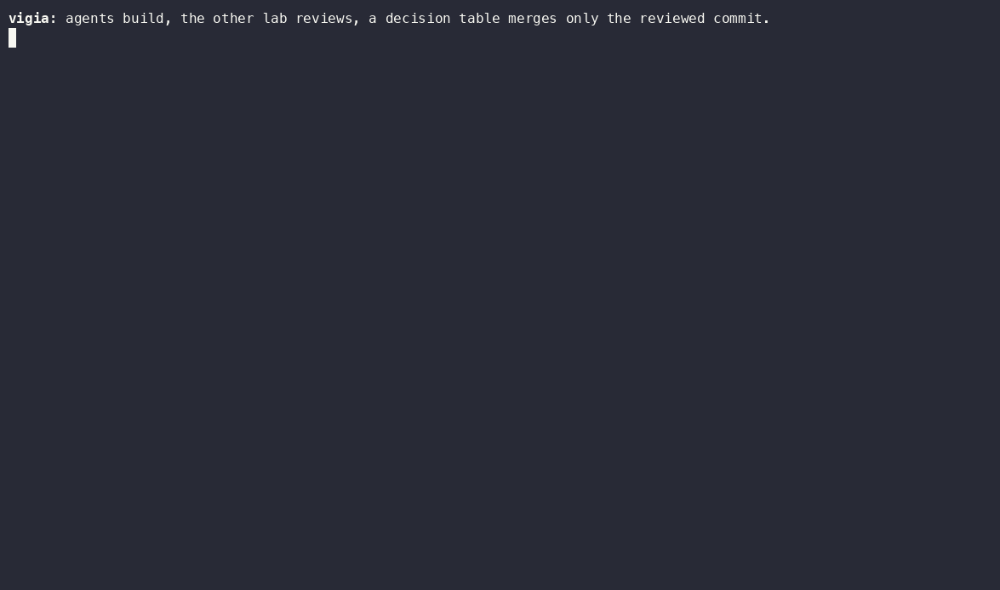
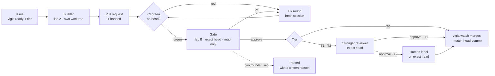

# vigia

**Agents build. The other lab reviews. A deterministic decision table merges only the reviewed commit.**

vigia is a small AI software factory: it takes GitHub issues to merged pull requests with coding agents from two
AI labs, Claude Code (Anthropic) and Codex CLI (OpenAI). An agent from one lab builds each change, a model from the other lab reviews it on its
exact commit, and a pure function, with no model in it, decides whether it merges. Every step is one line in an
append-only ledger.

> **Before you point it at a repository**
> - Agent sessions run as your OS user and can run shell commands: vigia is not a sandbox ([SECURITY.md](SECURITY.md)).
> - vigia pushes, comments and merges with your own `gh` login. The agent sessions never get that login.
> - It needs both CLIs logged in to a paid plan or an API key; every pull request uses sessions from both labs.
> - The riskiest tier, T2 (money, auth, personal data), adds the strongest reviewer and waits for you to add
>   `vigia:human-ok`.



*Recorded live on [vigia-demo](https://github.com/hector14mv/vigia-demo): issue #26, a T1 ticket, became PR #27,
built by Claude Sonnet, gated by Codex on its exact commit, reviewed by Claude Opus and merged by `vigia watch`.
Idle time is compressed; nothing else is edited.*

## Three rules

1. **Review depth is set by damage.** Every ticket has one tier, T0 to T2, defined in
   [the operating model](docs/operating-model.md#1-damage-sets-the-review-not-the-author): T0 for docs, tests
   and cosmetic changes, T1 for product logic, T2 for money, auth, personal data, migrations and the process
   itself. The tier, not the model that wrote the change, decides how much review it gets.
2. **The gate is always from the other lab.** A model from the other lab (the other company's model) reviews
   every change on the exact commit, in a read-only checkout: Codex gates Claude's work, and Claude gates
   Codex's work when a tier's builder is Codex (`vigia init --builder codex`). T1 and T2 add a second reviewer
   after the gate, and T2 waits for a person's label. No verdict means no merge.
3. **The merge is a decision table, not a judgement.** `rules.decide()` is a pure function (no model, no I/O)
   over CI status, verdicts and labels on the exact head, tested row by row in `tests/test_rules.py`. vigia
   merges only when it says so, with `gh pr merge --match-head-commit`.



On a pull request's path only four steps run a model, each in a fresh, headless session capped in time:
**build**, **fix**, **gate** and the **second review**. Everything else is deterministic code: ticket validation, commit, push, PR and handoff,
verdict parsing, caps and parking, the merge decision, and the ledger.

## Quickstart

### What you need

- macOS or Linux and git. vigia needs Python 3.11+, which uv installs for it if needed.
- [GitHub CLI](https://cli.github.com), [uv](https://docs.astral.sh/uv/) (or [pipx](https://pipx.pypa.io)),
  [Claude Code](https://code.claude.com/docs/en/setup) and [Codex CLI](https://github.com/openai/codex), each
  logged in. vigia uses those logins and never asks for or stores a token.
- A GitHub repository you can administer, with a CI workflow that runs on `pull_request`: vigia merges only
  when CI is green on the head (`vigia doctor` checks it).

On macOS:

```bash
brew install gh uv
curl -fsSL https://claude.ai/install.sh | bash          # Claude Code
curl -fsSL https://chatgpt.com/codex/install.sh | sh     # Codex CLI (or: npm install -g @openai/codex)
gh auth login && gh auth setup-git                       # setup-git lets git push with that login
claude auth login
codex login
```

On a Linux server, [docs/server.md](docs/server.md) has the same steps over SSH. With the tools logged in,
setting up a repository takes a few minutes, and a small T0 change then takes about five minutes from issue to
merge (on vigia-demo, issue #20 became merged PR #21 in 5 min 27 s).

> **Let an agent do it.** Paste [docs/agents/install.md](docs/agents/install.md) into Claude Code or Codex on the
> machine that should run vigia. It installs and configures everything and stops for you at every login.

### Install and set up a repository

```bash
uv tool install git+https://github.com/hector14mv/vigia
# or: pipx install git+https://github.com/hector14mv/vigia
```

If uv warns that its bin directory is not on your `PATH`, run `uv tool update-shell` and open a new terminal.
Then, in a clone of the repository vigia will work on:

```bash
vigia init
vigia doctor
```

`init` checks the four tools, asks which lab builds (the other one reviews), proposes models per tier, writes
`vigia.toml`, adds `.vigia/` to `.gitignore`, writes the ticket template to
`.github/ISSUE_TEMPLATE/vigia-ticket.md`, and creates the labels on GitHub. **Commit and push** those files:
GitHub shows the template only once it is on the default branch. `doctor` checks the tools, `vigia.toml`, the
repository, the labels, CI and the test command (not branch protection), and prints the fix for each problem.

Then protect the base branch on GitHub (branch rules need a public repository, or a paid plan for a private
one). In **Settings → Branches**, add a rule for `main` with:

- **Require status checks to pass before merging**, with the checks your CI reports (each job is a check, so
  pick the job names, not the workflow name);
- **Require branches to be up to date before merging**;
- **Do not allow bypassing the above settings**: vigia merges with your login, and an admin's merge would
  otherwise skip the rule.

Do not require approving reviews: vigia's reviews are comments, and a T2 approval is a label. With these rules
GitHub refuses to merge a PR whose base moved after its review; you press **Update branch** and vigia reviews the
new head like any other (see [Limitations](#limitations-of-v01)).

### Your first ticket

A ticket is a GitHub issue in a fixed shape: Outcome, Scope with `Not touched:` and `Must still hold:`,
acceptance criteria, a done-test and risks. The body is the builder's whole prompt, so it says what, not how.
Click *New issue* on GitHub and pick the "vigia ticket" template, or write `ticket.md` yourself. A small T0:

```markdown
## Outcome
`slugify()` has tests for empty text and for text with no letters or digits.

## Scope
`tests/test_textutil.py` only.
Not touched: `src/` and every public function.
Must still hold: every existing test passes unchanged.

## Acceptance criteria
- [ ] `slugify("")` returns `""`
- [ ] `slugify("!!!")` returns `""`

## Done-test
`pytest -q tests/test_textutil.py`

## Risks
None: tests only.
```

```bash
gh issue create --title "test: slugify() on empty text and text without letters" \
  --body-file ticket.md --label tier:T0 --label vigia:ready
vigia run       # build the oldest ready issue into a pull request, then stop
vigia watch     # the loop: CI → gate → fix → review → merge or park, until Ctrl-C
vigia status    # the queue, every open PR with its next step, parked reasons, recent events
```

`vigia:ready` is what starts a build: vigia builds an issue only when someone with write access to the
repository added that label, and removing it withdraws the approval. `vigia watch` runs until you press Ctrl-C, and it also builds ready issues. `vigia watch --once`
does a single tick and exits; `vigia watch --no-build` only moves PRs that are already open and builds nothing
new.

[`hector14mv/vigia-demo`](https://github.com/hector14mv/vigia-demo) is a tiny library where every pull request
went through exactly this: open any merged PR and read the handoff, the gate's verdict and the merge comment.

### Write tickets with Claude Code

The [`vigia-ticket`](skills/vigia-ticket/SKILL.md) skill turns a rough idea into an issue vigia accepts. Install
it for every project with:

```bash
git clone --depth 1 https://github.com/hector14mv/vigia "${TMPDIR:-/tmp}/vigia-src" && mkdir -p ~/.claude/skills && cp -R "${TMPDIR:-/tmp}/vigia-src/skills/vigia-ticket" ~/.claude/skills/
```

(or copy `skills/vigia-ticket/` into one repository's `.claude/skills/`), then ask Claude Code to "turn this
into a vigia ticket". `vigia ticket ticket.md` checks a body before you file it.

## How it works

**The builder** (`vigia run`, or `vigia watch` when the queue has work) takes the oldest ready issue, creates a
git worktree from the base branch under the system temp directory, and runs the tier's builder engine headless
(`claude -p …` or `codex exec …`) with the ticket as its brief. The engine only edits files and runs tests.
vigia commits, pushes, opens the PR with `Closes #N`, and posts a **handoff**: a comment with what changed, the
tests run, deviations from the ticket, risks and follow-ups. Its first line is `## Handoff <full sha>` and its
second is the `Engine:` line.

**The gate** is a fresh, read-only session from the other lab on a checkout of the PR's exact head. It gets the
ticket, the handoff and the diff, and must answer with a JSON verdict:

- **P1**: a defect on the changed path with a scenario that fails on this commit. It blocks the merge.
- **P2**: real, but not blocking.
- No parsable verdict is `GATE_UNAVAILABLE`: it holds the merge and is never read as a pass.

A P1 starts one **fix round**: a new builder session from the same lab, with only the findings as its brief.
The gate then reviews the new head. There are at most two gate rounds per PR; after that the PR is parked for a
person.

**T1 and T2** add a second reviewer on the same exact head, by default from the builder's lab: when Claude builds,
Claude Opus 5.5 on T1 and Claude Fable 5.1 on T2; when Codex builds, GPT-6.1 Sol (the builder's own model, in a
fresh read-only session) on T1 and GPT-6 Astra on T2. **T2** also waits for a person to add `vigia:human-ok` on that head. The label counts only if
GitHub recorded it after vigia first saw the head, so an approval never carries over to a later push (vigia also
removes the stale label, as a courtesy).

**The merge** is `rules.decide()`, a pure function tested row by row in
[`tests/test_rules.py`](tests/test_rules.py). In order: closed, parked or draft PRs are left alone; a PR that targets
a branch other than the base, a missing tier, an unknown builder, a same-lab gate or a conflict parks; CI must
be green on the head before any review; then the gate, the reviewer and the human label, each on the exact head
and each counted only for the PR's current tier; then `gh pr merge --squash --match-head-commit <sha>`. Right
before merging, vigia re-reads the PR and decides again. When a PR merges, each follow-up its handoffs list is
filed as a `vigia:follow-up` issue, never as ready: you decide whether it becomes a ticket.

**Crashes** are expected, not exceptional. Every paid step writes the ledger before its side effects on GitHub,
so a verdict is never paid for twice; at the start of each tick vigia parks a build that was interrupted,
finishes enrolling a PR whose labels failed, and removes review worktrees a killed session left behind.

**The ledger** is `.vigia/ledger.jsonl`: one JSON line per action (`pr_opened`, `verdict`, `fix_started`,
`pushed`, `parked`, `merged`, …), opened in append mode only. It is what the decisions read; the comments on
GitHub are the public copy.

The seven rules behind all of this, and where each one lives in the code, are in
[docs/operating-model.md](docs/operating-model.md).

## Failure modes

- **No parsable verdict**: `GATE_UNAVAILABLE`. It holds the merge and is never read as a pass.
- **The head moves**: verdicts and a T2 label count only for the commit they were given on, so a new head is
  reviewed again from CI on.
- **A cap is hit** (gate rounds, fix rounds, review passes, failed sessions, session length): the PR is parked
  with the reason written on it, and a person decides.
- **A crash mid-step**: every paid step is in the ledger before its effect on GitHub, and the next tick repairs
  from it: an interrupted build is parked, a half-enrolled PR is finished, leftover worktrees are removed.
- **No CI**: with `require_ci = true` (the default) a PR waits for a green CI result on its head, so a
  repository without a CI workflow never merges. `vigia init` and `vigia doctor` say so up front.
- **The base moves after the review**: v0.1 does not review the PR again; GitHub's "Require branches to be up to
  date" rule is the guard (see [Limitations](#limitations-of-v01)).
- **The issue body is the builder's prompt**, so `vigia:ready` is the trust boundary. vigia builds an issue only
  if that label was added by someone with write access, and only if the body and title have not changed since;
  otherwise it refuses the ticket and says why. Anyone who can add the label still decides what an engine is
  told to do.
- **It is not a sandbox**: engine sessions run as your OS user, with your files and your other logins. Read
  [SECURITY.md](SECURITY.md).

## Configuration

`vigia init` writes a `vigia.toml` like this one (every model is an exact id, never an alias):

```toml
[repo]
name = "you/your-repo"
base = "main"

[tiers.T0]
builder = { engine = "claude", model = "claude-sonnet-5-5", effort = "medium" }
gate = { engine = "codex", model = "gpt-6.1-sol", effort = "medium" }

[tiers.T1]
builder = { engine = "claude", model = "claude-sonnet-5-5", effort = "high" }
gate = { engine = "codex", model = "gpt-6.1-sol", effort = "medium" }
reviewer = { engine = "claude", model = "claude-opus-5-5", effort = "high" }

[tiers.T2]
builder = { engine = "claude", model = "claude-opus-5-5", effort = "high" }
gate = { engine = "codex", model = "gpt-6.1-sol", effort = "high" }
reviewer = { engine = "claude", model = "claude-fable-5-1", effort = "high" }
human = true

[caps]
gate_rounds = 2       # heads the gate may review per PR
fix_rounds = 2        # fix sessions per PR
review_rounds = 2     # stronger-reviewer passes per PR
attempts = 3          # failed sessions on one head before parking
session_minutes = 30  # wall-clock cap for one engine session

[checks]
require_ci = true
test_command = "python3 -m pytest -q"   # vigia runs it after each build and reports the result
humans = ["your-login"]                 # who may add vigia:human-ok (empty: anyone with write access)

[watch]
build = true             # `vigia watch` also builds ready issues
interval_seconds = 120   # between ticks
slots = 2                # engine sessions at once (gate, review, fix or build)
```

`checks.test_command` runs in the builder's worktree with whatever interpreter is on your `PATH`, not in your own
virtual environment, so the project's dependencies must be installed there (or the command must install them,
for example `uv run --with pytest pytest -q`).

To make Codex build and Claude review, run `vigia init --builder codex`. vigia refuses a config in which a tier's
gate comes from the same lab as its builder, a T2 without the human label, or a model given by alias.

## Parallel sessions and several repositories

`watch.slots` is how many engine sessions run at once. `vigia init` proposes a number from the machine (about
two cores and two GB of RAM per session, at most six) and from Codex's weekly quota when its CLI has recorded
one. With one slot, each tick runs at most one session inline. With more, the watcher starts each gate, review,
fix or build as its own `vigia job` process and moves on; a job holds a lock on its PR or issue for its whole
life, so no two sessions ever work on the same PR, and it re-reads GitHub and decides again before it spends a
session. Every PR still spends one gate from the other lab, so slots are also a quota decision.

To drive several repositories from one place, clone them side by side in one folder, run `vigia init` in each,
then in the folder itself:

```bash
vigia workspace            # writes vigia.workspace.toml: the clones below it and the slots they share
vigia watch                # every repo, sharing the slots
vigia status               # every repo
```

## Planning: from a goal to tickets you ratify

```bash
vigia plan "Article titles become short, readable URL slugs: a maximum length that never cuts a word, no accents"
```

A planner session (Claude Opus by default) reads the base branch, read-only, and writes tickets in the template,
with what it verified in the code under `## Facts`. vigia files every ticket as `vigia:proposed`, never as
ready: you read it and swap the label for `vigia:ready`, because what vigia builds next is your call. A
ticket that needs an earlier one of the plan merged first says which. Work only a person can do (an account, a
secret, a product decision) becomes a `vigia:human-task` issue. The Mesa shows both under "Your turn". A title
that is already an open issue's is not filed twice. `--dry-run` prints the plan without filing it.

## The Mesa

`vigia mesa` serves the Mesa (Spanish for "desk"), a read-only status page at http://127.0.0.1:8790 for a
laptop or a phone:

- **Your turn**: only what needs a person. A T2 change waiting for `vigia:human-ok`, with the evidence on its
  exact head; a parked PR, with the reason and what was tried; a ticket refused for missing sections.
- **Factory**: per repository, the sessions in use and every open PR on its path (build, CI, gate, review,
  human, merge) with its next step, plus the queue.
- **Feed**: what just happened, one ledger row per line.
- **Fuel**: what vigia has spent and has left. Codex's weekly quota (Claude Code keeps no quota file: read
  it with `/usage`), merges, P1s caught and engine sessions.

It is read-only on purpose: every action is a link to GitHub, where your login decides, because a button that
labels or approves would let any process on the machine act as you. It listens on 127.0.0.1 only; to open it
from your phone, put it behind `tailscale serve` (see [docs/server.md](docs/server.md)). Run it in a workspace
folder to see every repository.

## Commands

| Command | What it does |
|---|---|
| `vigia init [--repo OWNER/NAME] [--builder claude\|codex] [--yes] [--force] [--no-labels]` | check tools, choose engines per tier, write `vigia.toml`, create labels; `--repo` defaults to the clone's GitHub repo, `--yes` accepts the defaults, `--force` overwrites an existing `vigia.toml`, `--no-labels` skips creating labels |
| `vigia doctor [--json]` | check that vigia can work in this clone (tools, `vigia.toml`, repo, labels, CI workflow, test command, work root, lock); every problem comes with the command that fixes it; exit code 1 if any check fails |
| `vigia ticket FILE` | check a ticket body (`-` reads stdin): prints what is missing, exit code 1 if anything is |
| `vigia run [--issue N]` | build one ready issue into a pull request (default: the oldest ready one) |
| `vigia watch [--once] [--interval SECONDS] [--no-build] [--slots N]` | the loop, until Ctrl-C; merges and parks for every PR, and runs or starts engine sessions up to `watch.slots`; `--once` runs one tick, `--interval` sets the seconds between ticks (default `watch.interval_seconds`), `--no-build` only moves open PRs, `--slots` overrides the slots; in a workspace folder, every repo |
| `vigia status [--json \| --html PATH]` | queue, open PRs with their next step, parked reasons, recent ledger; `--json` prints JSON, `--html PATH` writes a self-contained HTML page and prints its path |
| `vigia mesa [--host H] [--port P] [--allow-host NAME]` | the read-only status page in a browser (default http://127.0.0.1:8790) |
| `vigia plan "<goal>" [--max N] [--dry-run]` | turn a goal into proposed tickets for you to ratify |
| `vigia report [--days N] [--json]` | the engine table: per builder and reviewer model, PRs, first-round P1s, gate rounds and minutes to merge |
| `vigia workspace [--slots N] [--force]` | write `vigia.workspace.toml` for the clones below this folder |
| `vigia review --pr N [--kind gate\|review]` | run the gate or the tier reviewer on a PR's head now |
| `vigia fix --pr N [--stage gate\|review\|ci]` | run one fix round now |
| `vigia --version` | print the installed version |

## Results

vigia is the private factory described in
[Dos laboratorios y un vigía](https://hectormoyanovelez.com/fabrica) (in Spanish), rewritten to run anywhere.
That factory merged 360 pull requests between 7 and 21 October 2026, written by Claude or Codex, reviewed by a
model from the other lab and merged by a decision table. It also kept a quality count: of the 117 problems found
in the 49 pull requests it merged from 7 to 11 October, 43 were serious (P1), and 31 of those came from the
ticket, not the builder: 17 from a ticket that stated something false about the code, 14 from one that left out
something that mattered. Its watcher was about 11,700 lines woven into one machine and one person's tools. vigia
brings over the factory, not just its core: parallel engine sessions and a workspace that drives several
repositories with a shared budget, the Mesa, a planner that turns a goal into tickets for you to ratify, an
engine report from the ledger, and a guide to run it all on an always-on server.

**vigia built vigia.** From 23 October 2026 until 25 October at 21:12 (Madrid), this repository and vigia-demo
ran on vigia itself. Their ledgers count 55 pull requests merged by `vigia watch`: 44 built by vigia's own builder
sessions, the other 11 by an interactive Claude Code session put through the same flow. Every one was gated on its
exact commit by a model from the other lab. The gate returned 106 P1 findings across 122 verdicts, no pull request
merged while the latest review of its head reported a P1, and 28 times a pull request was parked for a person
with the reason written on it. Each of those pull requests shows its handoff, verdicts and merge comment:
[vigia](https://github.com/hector14mv/vigia/pulls?q=is%3Apr+is%3Amerged+merged%3A%3C%3D2026-10-25T21%3A12%3A00%2B01%3A00)
and
[vigia-demo](https://github.com/hector14mv/vigia-demo/pulls?q=is%3Apr+is%3Amerged+merged%3A%3C%3D2026-10-25T21%3A12%3A00%2B01%3A00).
Several designs in this release changed because of what the gate found, and one feature, bringing a moved base
into a pull request, stayed out of v0.1 for the same reason.

## Limitations of v0.1

What comes next is in the [roadmap](docs/roadmap.md).

- Tested on macOS and Linux, with GitHub, Claude Code 2.1.294 and Codex CLI 0.159–0.164. No Windows, no GitLab,
  no other engines yet.
- Engine sessions run without your GitHub login, but as your OS user, with your files and your other logins:
  read [SECURITY.md](SECURITY.md) first, and give vigia its own OS user for real isolation.
- Engine sessions run without MCP servers, and Codex sessions without `~/.codex/config.toml`: there is no way
  yet to give a session MCP tools ([SECURITY.md](SECURITY.md)).
- Parallel sessions share one machine: there are no memory, disk or load gates yet beyond the slot count.
- A base that conflicts with a PR parks it; vigia does not resolve conflicts.
- vigia v0.1 does not re-review a PR whose base moved after its review
  ([#39](https://github.com/hector14mv/vigia/issues/39)). The guard is GitHub's own rule,
  **Require branches to be up to date before merging** (with at least one required check): turn it on, as the
  Quickstart says. Without it, a PR can merge onto base changes no reviewer saw together with it. With it, a
  stale PR is not parked yet: vigia's merge is refused, logged as an error and tried again on every tick until
  someone presses **Update branch** ([#59](https://github.com/hector14mv/vigia/issues/59)).
- The planner only proposes: you ratify every ticket it writes.
- The Mesa only reads: every action is a link to GitHub, where your own login decides.
- Fix rounds use the tier's builder engine, so they stay in the builder's lab.
- Not on PyPI yet: install from git.

## Development

```bash
uv run --with pytest --with ruff ruff check .
uv run --with pytest --with ruff ruff format --check .
uv run --with pytest --with ruff pytest
```

Tests never touch a real repository: the end-to-end test drives a real git remote created in a temporary
directory, with GitHub and the engines replaced by fakes (`tests/fakes.py`).

See [CONTRIBUTING.md](CONTRIBUTING.md) for how to propose and submit a change.

## License

MIT, see [LICENSE](LICENSE).
