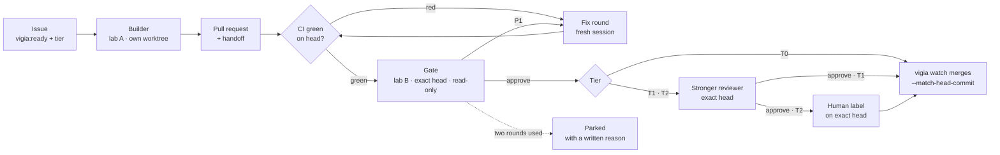

# vigia

**AI agents write the code. A different lab reviews it. A script with no AI merges it.**

vigia turns GitHub issues into merged pull requests with three rules that do not bend:

1. **Review depth is set by damage.** Every ticket has a tier — T0 (docs, tests, tooling), T1
   (product logic), T2 (money, auth, personal data, migrations, messages to customers). The tier,
   not the model that wrote the change, decides how much review it gets.
2. **The gate is always from the other lab.** A model from the other lab reviews every change on
   the exact commit, in a read-only checkout: Codex gates Claude's work, and Claude gates Codex's
   work when a tier's builder is Codex (`vigia init --builder codex`). T1 and T2 add a stronger
   reviewer after the gate, by default from the builder's lab. No verdict means no merge.
3. **The merge is a decision table, not a judgement.** `vigia watch` is plain Python that never
   calls a model. It merges only when every rule holds on the exact head, with
   `gh pr merge --match-head-commit`, and writes every step to an append-only ledger.

It is the small, runnable core of the private factory described in
[Dos laboratorios y un vigía](https://hectormoyanovelez.com/fabrica) (in Spanish): 360 pull
requests merged between 7 and 21 October 2026, written by Claude or Codex, reviewed by a model from
the other lab and merged by a Python program that calls no model. That watcher is about 11,700
lines woven into one machine and one person's tools; vigia is a clean rewrite of its core that you
can point at your own repository in fifteen minutes.



## Quickstart (about fifteen minutes)

The fifteen minutes run from install to your first merged pull request; a small T0 change takes
about three minutes end to end once vigia is set up.

> **Let an agent do it.** Paste [docs/agents/install.md](docs/agents/install.md) into Claude Code or Codex on the
> machine that should run vigia. It installs and configures everything and stops for you at every login. For an
> always-on factory on a server, with the Mesa on your phone, see [docs/server.md](docs/server.md).

You need macOS or Linux, Python 3.11+, git, [uv](https://docs.astral.sh/uv/) (or
[pipx](https://pipx.pypa.io)), and three CLIs logged in:
[GitHub CLI](https://cli.github.com) (`gh auth login`),
[Claude Code](https://docs.claude.com/en/docs/claude-code) (`claude auth login`) and
[Codex CLI](https://github.com/openai/codex) (`codex login`). vigia uses your existing logins and
subscriptions; it never asks for or stores a token.

```bash
uv tool install git+https://github.com/hector14mv/vigia
# or: pipx install git+https://github.com/hector14mv/vigia
```

If uv warns that its bin directory is not on your `PATH`, run `uv tool update-shell` and open a new
terminal.

In a clone of the repository you want vigia to work on:

```bash
vigia init
```

`init` checks the four tools, asks which lab builds (the other one reviews), proposes models per
tier, writes `vigia.toml`, adds `.vigia/` to `.gitignore`, writes the ticket template to
`.github/ISSUE_TEMPLATE/vigia-ticket.md`, and creates the labels on GitHub. Commit those files.

Then open an issue from the template — Outcome, Scope with `Not touched:` and `Must still hold:`,
acceptance criteria, a done-test, risks — and give it one tier label and `vigia:ready`. Either
click *New issue* on GitHub and pick the "vigia ticket" template, or create `ticket.md` yourself:
copy the section headings from `.github/ISSUE_TEMPLATE/vigia-ticket.md` and fill them in. A small
filled-in example:

```markdown
## Outcome
`truncate(text, n)` shortens text to at most n characters, cutting on a word boundary.

## Scope
`src/textutil.py` and its tests.
Not touched: any other function in `textutil.py`.
Must still hold: `truncate("short", 80)` returns `"short"` unchanged.

## Acceptance criteria
- [ ] `truncate("hello brave new world", 12)` returns `"hello brave"`
- [ ] a test covers a word longer than n

## Done-test
`pytest -q tests/test_textutil.py`

## Risks
None: a pure function with no I/O.
```

```bash
gh issue create --title "feat: truncate() shortens text on a word boundary" \
  --body-file ticket.md --label tier:T1 --label vigia:ready
vigia run       # build the oldest ready issue into a pull request, then stop
vigia watch     # the loop: CI → gate → fix → review → merge or park, until Ctrl-C
vigia status    # the queue, every open PR with its next step, parked reasons, recent events
```

`vigia watch` runs until you press Ctrl-C, and it also builds ready issues. `vigia watch --once`
does a single tick and exits; `vigia watch --no-build` only moves PRs that are already open and
builds nothing new.

[`hector14mv/vigia-demo`](https://github.com/hector14mv/vigia-demo) is a tiny library where every
pull request went through exactly this: open any merged PR and read the handoff, the gate's
verdict and the merge comment.

### Write tickets with Claude Code

The [`vigia-ticket`](skills/vigia-ticket/SKILL.md) skill turns a rough idea into an issue vigia
accepts. Install it by copying the `skills/vigia-ticket/` folder into `~/.claude/skills/` (every
project) or into a repository's `.claude/skills/`, then ask Claude Code to "turn this into a
vigia ticket".

## How it works

**The builder** (`vigia run`, or `vigia watch` when the queue has work) takes the oldest ready
issue, creates a git worktree from the base branch under the system temp directory, and runs the
tier's builder engine headless (`claude -p …` or `codex exec …`) with the ticket as its brief. The
engine only edits files and runs tests. vigia commits, pushes, opens the PR with `Closes #N`, and
posts a handoff whose first line is `## Handoff <full sha>` and whose second is the `Engine:` line.

**The gate** is a fresh, read-only session from the other lab on a checkout of the PR's exact head.
It gets the ticket, the handoff and the diff, and must answer with a JSON verdict:

- **P1** — a defect on the changed path with a scenario that fails on this commit. Blocks the merge.
- **P2** — real, not blocking.
- No parsable verdict is `GATE_UNAVAILABLE`: it holds the merge and is never read as a pass.

A P1 starts one **fix round**: a new builder session from the same lab, with only the findings as
its brief. The gate then reviews the new head. There are at most two gate rounds per PR; after
that the PR is parked for a human.

**T1 and T2** add a stronger reviewer on the same exact head (by default Claude Opus 5.5 for T1 and
Claude Fable 5.1 for T2). **T2** also waits for a person to add `vigia:human-ok` on that head. The
label counts only if GitHub recorded it after vigia first saw the head, so an approval never carries
over to a later push (vigia also removes the stale label, as a courtesy).

**The merge** is `rules.decide()`, a pure function tested row by row in
[`tests/test_rules.py`](tests/test_rules.py). In order: closed, parked or draft PRs are left alone;
a PR aimed at another branch than the base, a missing tier, an unknown builder, a same-lab gate or a
conflict parks; CI must be green on the head before any review; then the gate, the reviewer and the
human label, each on the exact head and each counted only for the PR's current tier; then
`gh pr merge --squash --match-head-commit <sha>`. Right before merging, vigia re-reads the PR and
decides again.

**Crashes** are expected, not exceptional. Every paid step writes the ledger before its side effects
on GitHub, so a verdict is never paid for twice; at the start of each tick vigia parks a build that
was interrupted, finishes enrolling a PR whose labels failed, and removes review worktrees a killed session
left behind.

**The ledger** is `.vigia/ledger.jsonl`: one JSON line per action (`pr_opened`, `verdict`,
`fix_started`, `pushed`, `parked`, `merged`, …), opened in append mode only. It is what the
decisions read; the comments on GitHub are the public copy.

The seven rules behind all of this, and where each one lives in the code, are in
[docs/operating-model.md](docs/operating-model.md).

## Configuration

`vigia init` writes a `vigia.toml` like this one (every model is an exact id, never an alias):

```toml
[repo]
name = "you/your-repo"
base = "main"

[tiers.T0]
builder = { engine = "claude", model = "claude-sonnet-5-5", effort = "medium" }
gate = { engine = "codex", model = "gpt-6.1-sol", effort = "medium" }

[tiers.T1]
builder = { engine = "claude", model = "claude-sonnet-5-5", effort = "high" }
gate = { engine = "codex", model = "gpt-6.1-sol", effort = "medium" }
reviewer = { engine = "claude", model = "claude-opus-5-5", effort = "high" }

[tiers.T2]
builder = { engine = "claude", model = "claude-opus-5-5", effort = "high" }
gate = { engine = "codex", model = "gpt-6.1-sol", effort = "high" }
reviewer = { engine = "claude", model = "claude-fable-5-1", effort = "high" }
human = true

[caps]
gate_rounds = 2       # heads the gate may review per PR
fix_rounds = 2        # fix sessions per PR
review_rounds = 2     # stronger-reviewer passes per PR
attempts = 3          # failed sessions on one head before parking
session_minutes = 30  # wall-clock cap for one engine session

[checks]
require_ci = true
test_command = "python3 -m pytest -q"   # vigia runs it after each build and reports the result
humans = ["your-login"]                 # who may add vigia:human-ok (empty: anyone with write access)
```

`checks.test_command` runs in the builder's worktree with whatever interpreter is on your `PATH`,
not in your own virtual environment, so the project's dependencies must be installed there (or the
command must install them, for example `uv run --with pytest pytest -q`).

To make Codex build and Claude review, run `vigia init --builder codex`. vigia refuses a config in
which a tier's gate comes from the same lab as its builder, a T2 without the human label, or a
model given by alias.

## Parallel sessions and several repositories

`watch.slots` in `vigia.toml` is how many engine sessions run at once. `vigia init` proposes a number from the
machine (about two cores and two GB of RAM per session, at most six) and from Codex's weekly quota when its CLI
has recorded one. With one slot, each tick runs at most one session inline. With more, the watcher starts each
gate, review, fix or build as its own `vigia job` process and moves on; a job holds a lock on its PR or issue
for its whole life, so no two sessions ever work on the same PR, and it re-reads GitHub and decides again before
it spends a session. Every PR still spends one gate from the other lab, so slots are also a quota decision.

To drive several repositories from one place, clone them side by side in one folder, run `vigia init` in each,
then in the folder itself:

```bash
vigia workspace            # writes vigia.workspace.toml: the clones below it and the slots they share
vigia watch                # every repo, sharing the slots
vigia status               # every repo
```

## Planning: from a goal to a full queue

```bash
vigia plan "Article titles become short, readable URL slugs: a maximum length that never cuts a word, no accents"
```

A planner session (Claude Opus by default) reads the base branch, read-only, and writes tickets in the
template, with what it verified in the code under `## Facts`. vigia files them as issues: a launchable T0 or T1
ticket goes straight to the queue with `vigia:ready`; a T2 ticket, one the template check refuses, or one that
needs an earlier ticket of the plan merged first, waits as `vigia:proposed` until a person reads it and swaps the label; work only a person can do (an account, a secret,
a product decision) becomes a `vigia:human-task` issue. The Mesa shows the last two under "Your turn".
`--dry-run` prints the plan without filing it, and `--propose-only` files everything as proposed.

## The Mesa

`vigia mesa` serves the factory's control desk at http://127.0.0.1:8790, for a laptop or a phone:

- **Your turn** — only what needs a person: a T2 change waiting for `vigia:human-ok` with the evidence on its
  exact head, a parked PR with the reason and what was tried, a ticket refused for missing sections.
- **Factory** — per repository, the sessions in use and every open PR on its path (build, CI, gate, review,
  human, merge) with its next step, plus the queue.
- **Feed** and **Fuel** — what just happened, Codex's weekly quota (Claude Code keeps no quota file: read it
  with `/usage`), merges, P1s caught and engine sessions.

It is read-only on purpose: every action is a link to GitHub, where your login decides, because a button that
labels or approves would let any process on the machine act as you. It listens on 127.0.0.1 only; to open it
from your phone, put it behind `tailscale serve` (see [docs/server.md](docs/server.md)). Run it in a workspace
folder to see every repository.

## Commands

| Command | What it does |
|---|---|
| `vigia init [--repo OWNER/NAME] [--builder claude\|codex] [--yes] [--force] [--no-labels]` | check tools, choose engines per tier, write `vigia.toml`, create labels; `--repo` defaults to the clone's GitHub repo, `--yes` accepts the defaults, `--force` overwrites an existing `vigia.toml`, `--no-labels` skips creating labels |
| `vigia run [--issue N]` | build one ready issue into a pull request (default: the oldest ready one) |
| `vigia watch [--once] [--interval SECONDS] [--no-build] [--slots N]` | the loop, until Ctrl-C; merges and parks for every PR, and runs or starts engine sessions up to `watch.slots`; `--once` runs one tick, `--interval` sets the seconds between ticks (default `watch.interval_seconds`), `--no-build` only moves open PRs, `--slots` overrides the slots; in a workspace folder, every repo |
| `vigia plan "<goal>" [--max N] [--dry-run] [--propose-only]` | turn a goal into tickets and fill the queue |
| `vigia mesa [--host H] [--port P] [--allow-host NAME]` | the read-only control desk in a browser (default http://127.0.0.1:8790) |
| `vigia workspace [--slots N] [--force]` | write `vigia.workspace.toml` for the clones below this folder |
| `vigia status [--json \| --html PATH]` | queue, open PRs with their next step, parked reasons, recent ledger; `--json` prints JSON, `--html PATH` writes a self-contained HTML page and prints its path |
| `vigia doctor [--json]` | check that vigia can work in this clone (tools, `vigia.toml`, repo, labels, CI workflow, test command, work root, lock); every problem comes with the command that fixes it; exit code 1 if any check fails |
| `vigia review --pr N [--kind gate\|review]` | run the gate or the tier reviewer on a PR's head now |
| `vigia fix --pr N [--stage gate\|review\|ci]` | run one fix round now |
| `vigia --version` | print the installed version |

## Limitations of v0.1

What comes next is in the [roadmap](docs/roadmap.md).

- Tested on macOS and Linux, with GitHub, Claude Code 2.1.294 and Codex CLI 0.159–0.164. No Windows, no
  GitLab, no other engines yet.
- Parallel sessions share one machine: there are no memory, disk or load gates yet beyond the slot count.
- A PR that conflicts with its base is parked, not rebased.
- Fix rounds use the tier's builder engine, so they stay in the builder's lab.
- The ledger lives in the clone you run vigia from; run it from one place.
- Engines run with your credentials and permissions — read [SECURITY.md](SECURITY.md) first.
- Not on PyPI yet: install from git.

## Development

```bash
uv run --with pytest --with ruff ruff check .
uv run --with pytest --with ruff ruff format --check .
uv run --with pytest --with ruff pytest
```

Tests never touch a real repository: the end-to-end test drives a real git remote created in a
temporary directory, with GitHub and the engines replaced by fakes (`tests/fakes.py`).

See [CONTRIBUTING.md](CONTRIBUTING.md) for how to propose and submit a change.

## License

MIT — see [LICENSE](LICENSE).
